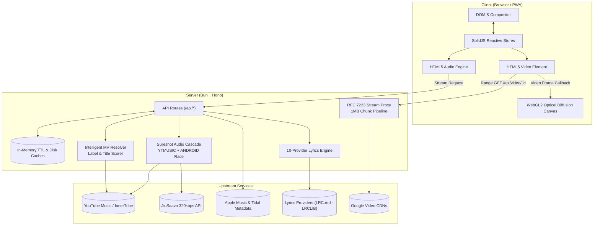

# VYUNE — Feel Every Frequency

<p align="center">
  <strong>Premium music streaming client with Apple-inspired liquid glass aesthetics, real-time synced lyrics, and intelligent music video integration.</strong>
</p>

<p align="center">
  
  
  
  
  
</p>

---

## Highlights

### ⚡ Sureshot Instant Audio Engine
- **Parallel Client Race**: Concurrently races `YTMUSIC` and `ANDROID` clients (`Promise.any`) to bypass YouTube web decipher blocks and long timeouts.
- **Sub-Second Lookup**: Resolves audio streams in **~110ms (cached) to ~800ms (fresh)** without manual play/pause taps.
- **Immediate Track Handoff**: Terminating previous audio instantly upon switching tracks to guarantee zero audio overlap.
- **High-Bitrate JioSaavn Fallback**: Seamless, automatic cascade to JioSaavn 320 kbps AAC streams if a YouTube stream is unavailable.

### 🎬 3-Mode Cinematic Player & Stage
- **Art Mode (Default)**: Classical 1:1 square vinyl/album art presentation with Apple Motion artwork and static ambient lighting.
- **Visualizer Mode**: Seamless alternating loop between high-definition Live Canvas and 30-second official MV highlights.
- **Official MV Mode**: Dynamic 16:9 widescreen stage (`aspect-ratio: 16/9`) that plays the complete official YouTube music video edge-to-edge.
- **Zero Black Bars Detection**: Real-time canvas scanner detects encoded letterboxing or pillarboxing and applies dynamic micro-transforms to fill the screen naturally.
- **Micro-Drift Sync**: Nudges video playback speed subtly (±5%) to keep audio and video in strict lockstep within ±150ms without buffering stalls.

### 🧠 Intelligent Official MV Picker
- **Authority Scorer**: Automatically scores YouTube search results, prioritizing verified artists and major record labels (*Sony Music, T-Series, Zee Music Company, YRF, Saregama, VEVO*).
- **8K / 4K Remaster Detection**: Detects modern 8K 60fps / 4K UHD remastered re-releases from official labels.
- **Strict Non-MV Filtering**: Heavily penalizes and eliminates lyrical videos, audio-only tracks, teasers, behind-the-scenes clips, and fan covers.
- **1080p Hardware-Accelerated Streaming**: Automatically caps 4K/8K video streams at **1080p MP4**, preventing GPU decoding lag and conserving bandwidth while retaining pristine sharpness.

### 🪟 Crystalline Liquid Glass Ambient Backdrop
- **Optical WebGL2 Tent Filter**: 13-tap tent diffusion shader reading deep mip levels for a velvety, smooth optical field.
- **Zero Noise Grain & Dirty Grey**: Pure optical chroma transmission preserves authentic video colors with zero artificial noise or muddy grey wash.
- **Fluid 24 FPS Sampling**: Ambient texture upload is sampled at 24 FPS with temporal alpha lerping, reducing GPU memory traffic by 60% and eliminating UI frame hitching.
- **Specular Refraction**: Translucent glass rims and specular sheen (`linear-gradient(135deg, rgba(255,255,255,0.07) ...)`) create depth without heavy CSS backdrop-blur passes.

### 🎤 Multi-Tier Synced Lyrics Pipeline
- **10-Provider Race**: Simultaneously queries *AMLL, lrc.red, BiniLyrics, NetEase, KuGou, Better Lyrics, LRCLIB*, and more.
- **Word-by-Word TTML & Line-Synced LRC**: Prioritizes fine word-timed karaoke sheets over line-synced lyrics.
- **Background Upgrade**: Renders line-synced lyrics instantly while hunting for word-timed sheets in the background.

---

## System Architecture



> 📖 **Deep Dive**: For comprehensive system specifications, state topology, and shader math, read **[docs/ARCHITECTURE.md](docs/ARCHITECTURE.md)** and **[docs/SYSTEM_DESIGN.md](docs/SYSTEM_DESIGN.md)**.

---

## Quick Start

### Prerequisites
- [Bun](https://bun.sh/) (v1.1+ recommended)

### Installation & Launch

```bash
# 1. Install root dependencies and web workspace
bun install

# 2. Build the SolidJS frontend into dist/
bun run build

# 3. Start the production server on http://localhost:3000
bun start
```

### Development Mode

```bash
# Start server in watch mode with live reloading
bun run dev

# Or run frontend dev server independently
cd web && bun dev
```

### Running Tests

```bash
# Run unit and contract tests
bun test

# Run Playwright end-to-end integration suite
bun run test:e2e

# Run Sureshot audio & 16:9 layout verification
node tests/test-sureshot-16-9.mjs

# Run intelligent MV resolver verification
node tests/test-intelligent-mv.mjs
```

---

## Environment Variables

Configure optional environment variables via your shell or a local `.env` file:

| Variable | Description | Default |
| :--- | :--- | :--- |
| `PORT` | Local port for Hono HTTP server | `3000` |
| `YT_PO_TOKEN_PROVIDER_URL` | Base URL for private BgUtils-compatible PO token service | `undefined` |
| `YT_PO_TOKEN` | Direct static YouTube Proof-of-Origin token | `undefined` |
| `YT_COOKIE` | YouTube session cookie for restricted content | `undefined` |
| `LYRICS_DEBUG` | Verbose debug logging for lyrics resolver cascade (`1` to enable) | `undefined` |
| `TIDAL_ACCESS_TOKEN` | Optional Tidal access token for high-res album motion video | `undefined` |

---

## Keyboard Shortcuts

| Key | Action |
| :--- | :--- |
| <kbd>Space</kbd> | Toggle Play / Pause |
| <kbd>J</kbd> / <kbd>←</kbd> | Seek backward 5 seconds |
| <kbd>L</kbd> / <kbd>→</kbd> | Seek forward 5 seconds |
| <kbd>K</kbd> | Toggle Play / Pause |
| <kbd>↑</kbd> | Increase volume 5% |
| <kbd>↓</kbd> | Decrease volume 5% |
| <kbd>M</kbd> | Toggle Mute |
| <kbd>F</kbd> | Toggle Full-Screen Now Playing overlay |
| <kbd>Esc</kbd> | Dismiss Full-Screen Player or Dialogs |

---

## Project Structure

```
vyune/
├── server/                    # Bun + Hono backend service
│   ├── index.js               # Route handlers, caching middleware, server boot
│   ├── yt.js                  # Sureshot YouTube resolution & Intelligent MV Picker
│   ├── videoStream.js         # RFC 7233 1080p chunked video streaming proxy
│   ├── saavn.js               # JioSaavn 320 kbps stream & search cascade
│   ├── identify.js            # Song canonical identity & ISRC resolver
│   ├── match.js               # Strict recording match verification
│   └── lyrics/                # 10-provider concurrent lyrics engine
├── web/                       # SolidJS + Tailwind v4 Single-Page Application
│   ├── src/
│   │   ├── components/music/  # AppleMotionArtwork, MotionFrost, TrackList
│   │   ├── components/ui/     # LiquidGlass, GlassPill, Sliders
│   │   ├── shell/             # FullScreenPlayer, ArtworkBackdrop, Layout
│   │   ├── store/             # player.ts, artMode.ts (Fine-grained Solid stores)
│   │   └── styles/            # tokens.css, system.css, glass.css
│   └── build.ts               # Bun native bundler build script
├── docs/                      # Architectural & design documentation
│   ├── ARCHITECTURE.md        # Deep architectural blueprint & sequence diagrams
│   └── SYSTEM_DESIGN.md       # Principles, caching table, and failure models
└── tests/                     # Playwright & automated verification suites
```

---

## Credits & Acknowledgements

- **Design Philosophy**: Measurements and UX topology inspired by modern Apple Music web standards.
- **Lyrics Rendering**: Powered by [am-lyrics](https://github.com/uimaxbai/am-lyrics) (MPL-2.0).
- **Typography**: [Inter Variable](https://rsms.me/inter/) by Rasmus Andersson (OFL).
- **YouTube InnerTube**: Powered by [YouTube.js](https://github.com/LuanRT/YouTube.js).

---

## License

Distributed under the [MIT License](LICENSE).
