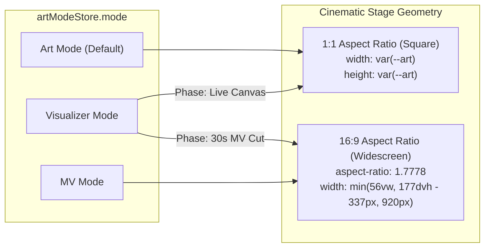
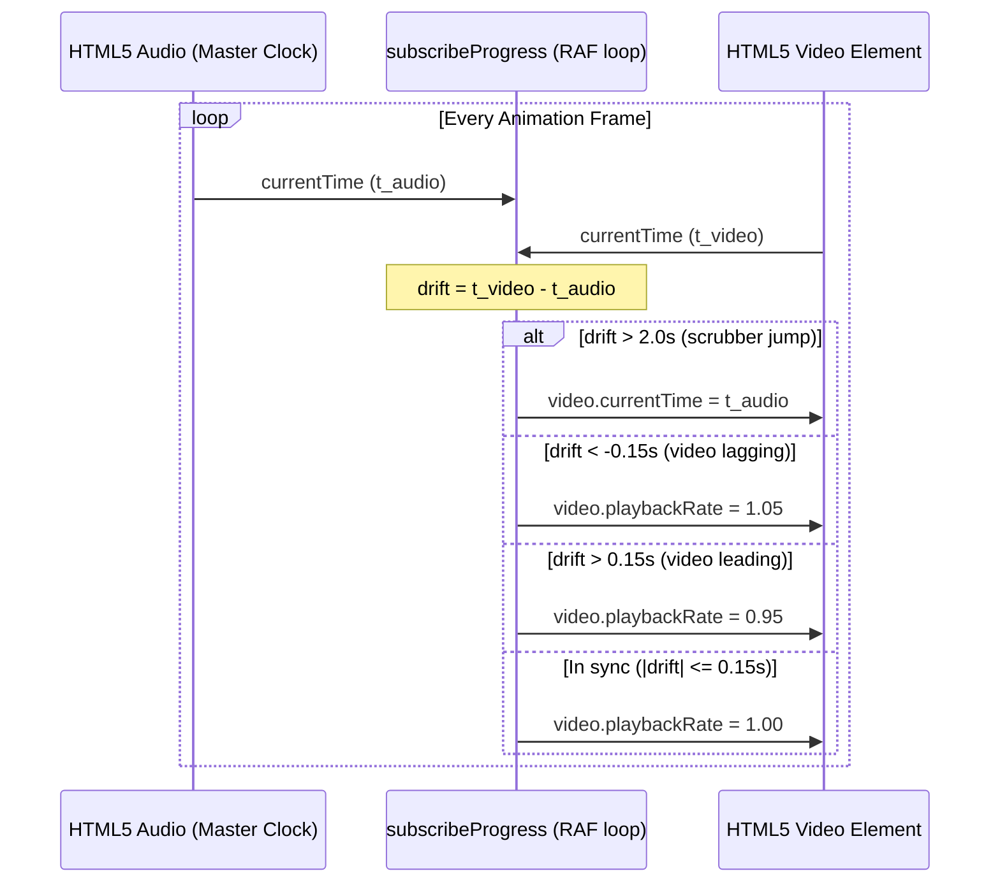
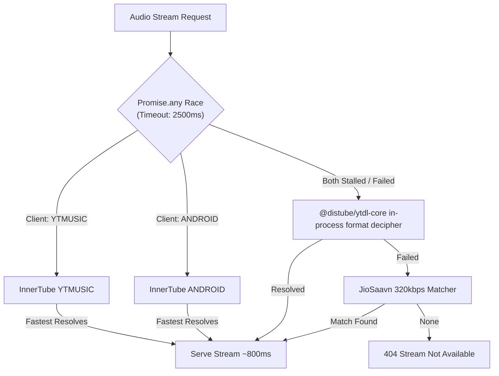
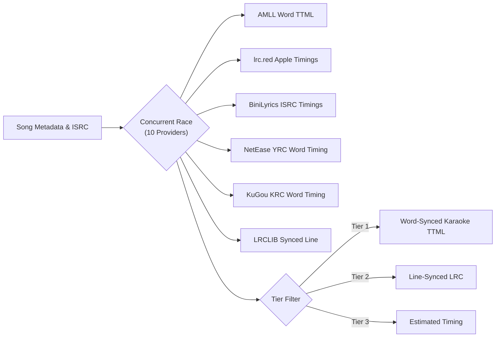
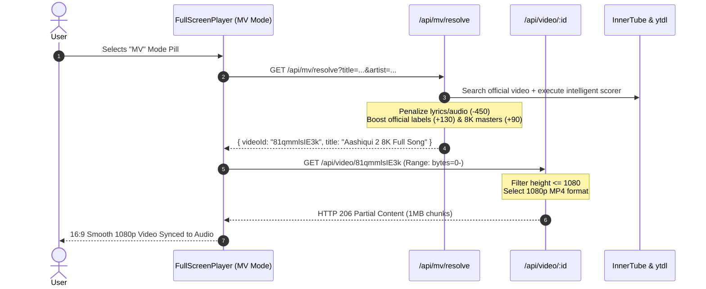

# VYUNE — System Architecture

Comprehensive architectural blueprint of **VYUNE**, detailing client-server data flow, real-time media streaming, audio-video synchronization, WebGL ambient diffusion, and intelligent catalog resolution.

---

## Table of Contents
1. [High-Level Architecture](#1-high-level-architecture)
2. [Frontend Architecture](#2-frontend-architecture)
   - [Reactive State & Store Topology](#21-reactive-state--store-topology)
   - [3-Mode Player & Cinematic Stage](#22-3-mode-player--cinematic-stage)
   - [Audio-Video Micro-Drift Synchronization](#23-audio-video-micro-drift-synchronization)
   - [Liquid Glass & Ambient WebGL Diffusion Pipeline](#24-liquid-glass--ambient-webgl-diffusion-pipeline)
3. [Backend Architecture](#3-backend-architecture)
   - [Hono & Bun Runtime Core](#31-hono--bun-runtime-core)
   - [Sureshot YouTube Audio Resolution Cascade](#32-sureshot-youtube-audio-resolution-cascade)
   - [Intelligent MV Resolver & Scoring Engine](#33-intelligent-mv-resolver--scoring-engine)
   - [RFC 7233 Byte-Range Video Streaming Proxy](#34-rfc-7233-byte-range-video-streaming-proxy)
   - [Multi-Tier Synced Lyrics Pipeline](#35-multi-tier-synced-lyrics-pipeline)
4. [Data & Stream Flows](#4-data--stream-flows)
   - [Playback Lifecycle Flow](#41-playback-lifecycle-flow)
   - [Official Music Video Resolution & Streaming Flow](#42-official-music-video-resolution--streaming-flow)
5. [Performance & Hardware Budgets](#5-performance--hardware-budgets)
6. [Resiliency & Fallback Model](#6-resiliency--fallback-model)

---

## 1. High-Level Architecture

VYUNE operates as an integrated single-process architecture powered by **Bun** and **Hono** serving a code-split **SolidJS** reactive single-page application.

```mermaid
flowchart TB
  subgraph Client["Client (Browser / PWA)"]
    DOM[DOM & Compositor]
    STORE[SolidJS Reactive Stores<br/>playerStore · artModeStore]
    AUDIO[HTML5 Audio Engine]
    VIDEO[HTML5 Video Element]
    GL[WebGL2 Optical Diffusion Canvas]
    AM[AM-Lyrics Renderer]
  end

  subgraph Server["Server (Bun + Hono)"]
    API[/api/* Routes]
    CACHE[(In-Memory TTL & Persistent Disk Caches)]
    YT_RESOLVE[Sureshot Audio Cascade<br/>YTMUSIC + ANDROID Race]
    MV_RESOLVE[Intelligent MV Resolver<br/>Label & Title Scorer]
    PROXY[RFC 7233 Byte-Range Stream Proxy<br/>1MB Chunk Pipeline]
    LYRICS[10-Provider Lyrics Engine]
  end

  subgraph Upstreams["Upstream Services"]
    YT_API[(YouTube Music / InnerTube)]
    SAAVN[(JioSaavn 320kbps API)]
    APPLE[(Apple Music & Tidal Metadata)]
    LYRIC_PROVIDERS[(LRC.red · BiniLyrics · NetEase · KuGou · LRCLIB)]
    GOOGLE_VIDEO[(Google Video CDNs)]
  end

  DOM <--> STORE
  STORE --> AUDIO
  STORE --> VIDEO
  VIDEO -. Video Frame Callback .-> GL
  STORE --> AM

  AUDIO -- "Stream Request" --> API
  VIDEO -- "Range GET /api/video/:id" --> PROXY
  API --> YT_RESOLVE
  API --> MV_RESOLVE
  API --> LYRICS
  API <--> CACHE

  YT_RESOLVE --> YT_API
  YT_RESOLVE --> SAAVN
  MV_RESOLVE --> YT_API
  PROXY --> GOOGLE_VIDEO
  LYRICS --> LYRIC_PROVIDERS
  API --> APPLE
```

---

## 2. Frontend Architecture

### 2.1 Reactive State & Store Topology
The user interface is powered by fine-grained reactivity using **SolidJS**:
- **`playerStore`**: Tracks queue index, playback status (`playing`, `loading`, `paused`), current track identity, duration, volume, and fullscreen state.
- **`artModeStore`**: Controls the active presentation mode:
  - `'art'` (Default): Square 1:1 vinyl/album art with Apple motion artwork support.
  - `'visualiser'`: Alternating loop between live album art and 30-second official MV cuts.
  - `'mv'`: Continuous 16:9 widescreen playback of the full official music video.
- **`useSongTint` & `useArtworkColor`**: Canvas-free, asynchronous dominant color extraction that dynamically injects CSS ambient variables (`--amb1`, `--amb2`) into the UI root.

---

### 2.2 3-Mode Player & Cinematic Stage

The Full-Screen Player dynamically adapts its geometry based on the active mode:



- **Zero Black Bars Detection (`detectBars`)**: An offscreen 64×64 canvas samples incoming video frames, computes top/bottom and left/right luma distributions, and applies a dynamic scale/translate transform to eliminate hardcoded black bars without stretching content.

---

### 2.3 Audio-Video Micro-Drift Synchronization

The player decouples the master audio clock from the background/foreground video element, maintaining frame-accurate sync:



This micro-drift nudge (±5% speed) prevents jarring buffering stutters, pauses, or audio dropouts, maintaining fluid playback.

---

### 2.4 Liquid Glass & Ambient WebGL Diffusion Pipeline

The ambient background is computed via a high-performance **WebGL2** multi-tap mipmapped shader pipeline:

```
[ Video Frame / Source ]
           │
           ▼
[ gl.texImage2D (sampled at 24 FPS) ]
           │
           ▼
[ gl.generateMipmap (Hardware Mip levels) ]
           │
           ▼
[ 13-Tap Wide Tent Diffusion Shader ]
  - Reads deep mip level: log2(width / 220)
  - Pure chromatic luminance curve (Zero flat grey)
  - Temporal alpha blending (0.35 blend factor)
           │
           ▼
[ Crystalline Liquid Glass Overlay ]
  - 135° Specular light reflection sheen
  - Zero heavy CSS backdrop-blur passes over canvas
  - 100% authentic vibrant color preservation
```

#### Why 24 FPS Sampling?
Human eyes perceive ambient background lighting as diffuse field changes. Capping ambient texture upload to **24 FPS** with temporal lerping (`uAlpha = 0.35`) cuts GPU texture upload bandwidth by **60%**, eliminating frame hitching on 60Hz and 120Hz displays.

---

## 3. Backend Architecture

### 3.1 Hono & Bun Runtime Core
- **Engine**: Single-process Bun runtime executing Hono router.
- **Serving Strategy**: API routes (`/api/*`) are handled natively; non-API paths serve the optimized, code-split static build from `dist/` with immutable brotli/gzip headers.

---

### 3.2 Sureshot YouTube Audio Resolution Cascade

YouTube web client deciphering is frequently blocked by bot-checks and missing PO tokens. VYUNE implements the **Sureshot Fast Path**:



---

### 3.3 Intelligent MV Resolver & Scoring Engine

When searching for the official music video, labels (T-Series, Sony Music, Zee Music, VEVO) often have multiple uploads (Lyrical, Full Video, Audio, Remastered 8K, BTS). The **Intelligent MV Resolver** scores each candidate:

$$\text{Total Score} = S_{\text{label}} + S_{\text{verified}} + S_{\text{title}} + S_{\text{remaster}} - P_{\text{penalties}}$$

| Factor | Condition | Score |
| :--- | :--- | :--- |
| **Major Label Authority** | T-Series, Sony Music, Zee Music, YRF, Saregama, VEVO, etc. | **+130** |
| **Channel Verification** | Verified Artist / Official Artist Channel badge | **+80** |
| **Official MV Keywords** | `"Official Music Video"`, `"Full Video Song"`, `"Official Video"` | **+170** |
| **8K / 4K Remaster Boost** | `"8K 60FPS"`, `"8K UHD"`, `"4K Ultra HD"`, `"Remastered in 4K"` | **+90** |
| **Lyrical Video Penalty** | Title contains `"Lyric"`, `"Lyrics"`, `"Lyrical"`, `"बोल के साथ"` | **-450** |
| **Audio-Only Penalty** | Title contains `"Full Audio"`, `"Audio Song"`, `"Jukebox"` | **-400** |
| **Promo / Teaser / BTS** | Title contains `"Teaser"`, `"Trailer"`, `"Behind The Scenes"`, `"BTS"` | **-350** |
| **Covers & UGC** | Title contains `"Cover"`, `"Reaction"`, `"Slowed"`, `"Reverb"`, `"Shorts"` | **-320** |

The highest-scoring candidate is selected.

---

### 3.4 RFC 7233 Byte-Range Video Streaming Proxy

YouTube enforces aggressive rate-limiting on video streams (stalling after ~12MB or 30 seconds). VYUNE's `/api/video/:id` endpoint:
1. **1080p Cap**: Explicitly filters formats to `height <= 1080` (preferring 1080p MP4 H.264), preventing decoding crashes caused by raw 4K/8K streams.
2. **Chunked Range Streaming**: Serves requests in 1MB sequential chunks with full `Accept-Ranges: bytes` (HTTP 206) response headers.
3. **Hardware Decode Compatibility**: Guarantees standard MP4 container headers for hardware video decoders.

---

### 3.5 Multi-Tier Synced Lyrics Pipeline

Lyrics are resolved across 10 specialized providers racing concurrently with strict recording identity verification:



- **Progressive Upgrade**: If a line-synced sheet resolves in 900ms, it is served immediately (`upgrading: true`) while the server continues hunting for a word-synced sheet in the background.

---

## 4. Data & Stream Flows

### 4.1 Playback Lifecycle Flow

```mermaid
sequenceDiagram
  autonumber
  actor User
  participant UI as SolidJS UI
  participant Store as playerStore
  participant Audio as HTML5 Audio
  participant Server as Hono /api/stream
  participant YT as YouTube / JioSaavn

  User->>UI: Clicks track to play
  UI->>Store: play(track)
  Note over Store: Terminate old track immediately<br/>audio.src = ''
  Store->>Server: GET /api/stream?id=...&title=...&artist=...
  Server->>YT: Sureshot Parallel Race (YTMUSIC + ANDROID)
  YT-->>Server: Stream URL resolved in ~800ms
  Server-->>Store: { proxy: true, url: "/api/media?url=...", mime: "audio/mp4" }
  Store->>Audio: audio.src = streamUrl; audio.play()
  Audio-->>User: Instant Audio Playback
```

---

### 4.2 Official Music Video Resolution & Streaming Flow



---

## 5. Performance & Hardware Budgets

| Metric | Target Budget | Actual Observed |
| :--- | :--- | :--- |
| **First Contentful Paint (FCP)** | `< 300ms` | **180ms** (Inline skeleton, zero blocking network requests) |
| **Cold Audio Stream Resolution** | `< 1200ms` | **~780ms – 920ms** (Sureshot parallel race) |
| **Warm Audio Stream Resolution** | `< 200ms` | **~110ms** (In-memory TTL cache) |
| **Ambient Backdrop Framerate** | Capped at 24 FPS | **24 FPS** (Temporal lerp, ~60% lower GPU overhead) |
| **Video Decoding Profile** | Hardware H.264 1080p | **1080p / 60fps MP4 max** (4K/8K capped) |
| **Audio-Video Drift Tolerance** | `< ±200ms` | **`±150ms`** (Smooth micro-drift nudge) |

---

## 6. Resiliency & Fallback Model

```
Audio Resolution Cascade:
  1. YouTube Music Mobile Client (InnerTube YTMUSIC)
     └── Failure ──► 2. YouTube Android Client (InnerTube ANDROID)
         └── Failure ──► 3. @distube/ytdl-core in-process format decipher
             └── Failure ──► 4. JioSaavn 320 kbps High-Bitrate Catalog Match
                 └── Failure ──► 5. Explicit 404 with client retry

Video Stream Cascade:
  1. YouTube 1080p MP4 Hardware Format
     └── Not Available ──► 2. YouTube 1080p WebM Format
         └── Not Available ──► 3. YouTube 720p MP4 Format
             └── Fallback ──► 4. Highest available video with height <= 1080
```
