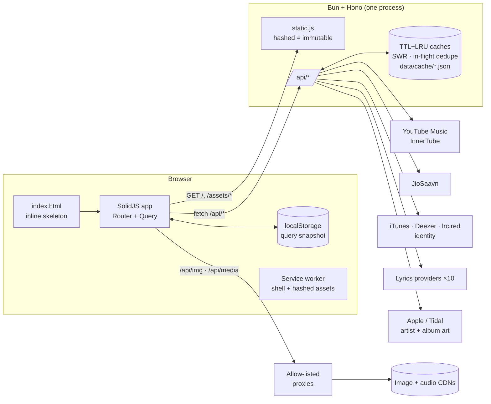
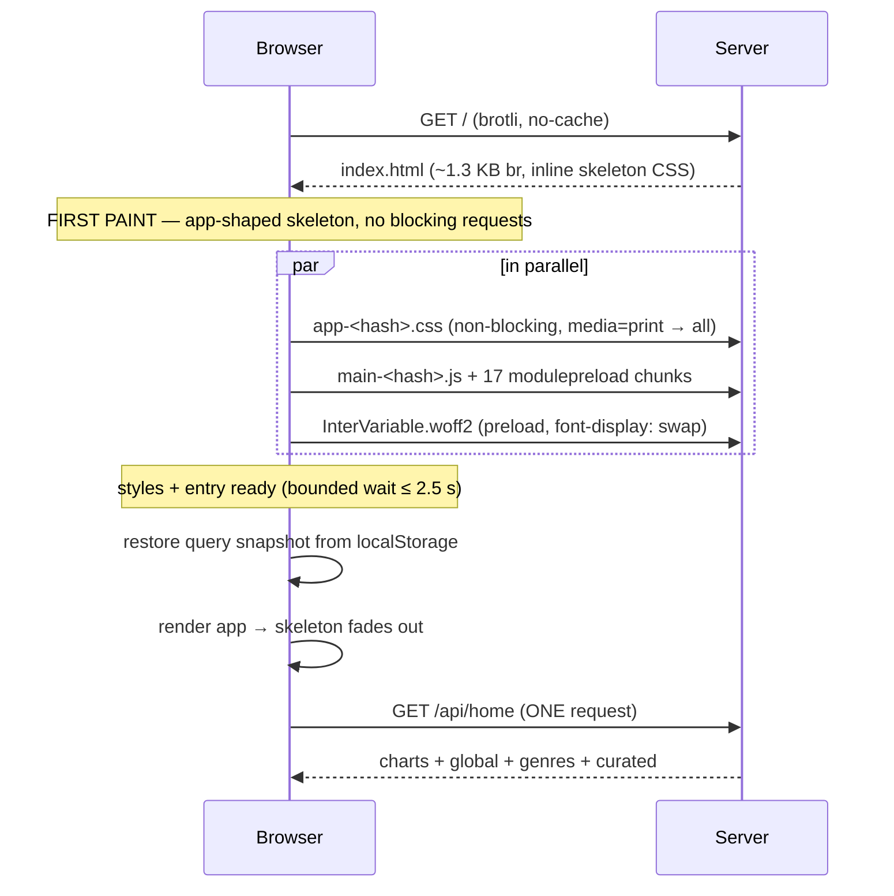
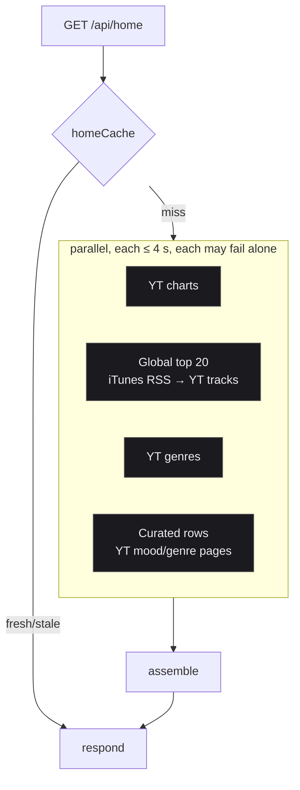
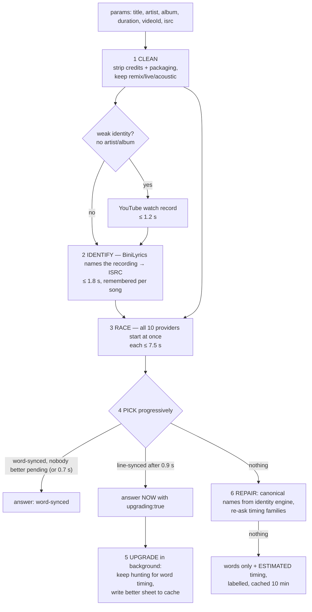

# VYUNE — System Design

How the site fetches everything: what runs where, what is cached, what is allowed to fail, and why.
For detailed architectural blueprints, state machine diagrams, and stream pipeline specifications, see **[ARCHITECTURE.md](ARCHITECTURE.md)**.

- [1. Principles](#1-principles)
- [2. The shape of the system](#2-the-shape-of-the-system)
- [3. First load: from URL to pixels](#3-first-load-from-url-to-pixels)
- [4. The data layer](#4-the-data-layer)
- [5. Playing a song](#5-playing-a-song-the-stream-cascade)
- [6. Lyrics](#6-lyrics)
- [7. Images, artwork and motion](#7-images-artwork-and-motion)
- [8. Caching, in one table](#8-caching-in-one-table)
- [9. Failure model](#9-failure-model)
- [10. Design system](#10-design-system)
- [11. Testing](#11-testing)

---

## 1. Principles

1. **Paint first, fetch second.** The first frame never waits for the network. The document carries its own skeleton; data fills in behind it.
2. **One request per screen.** A page asks the server for everything it needs at once. The server does the fan-out.
3. **Everything upstream can fail; nothing throws.** Every provider returns a value or `null`. Every wait has a budget. A slow source costs its own budget, never the page's.
4. **Stale beats empty.** Caches serve stale data instantly and refresh behind it (stale-while-revalidate), on the server *and* in the browser.
5. **A miss is recoverable; a wrong match is not.** Anything that identifies a *recording* (audio, lyrics) is judged by strict matchers. Showing nothing is better than showing a cover's words.
6. **Names carry freshness.** A file that can be cached forever has its content hash in its name. Everything else is revalidated.

---

## 2. The shape of the system



**Runtime:** one Bun process. Hono routes `/api/*`; everything else is the static build in `dist/`. Node works as a fallback (`dev:node`).

**Server modules**

| File | Responsibility |
|---|---|
| `index.js` | Routes, API caching headers, warm start, boot |
| `cache.js` | `TTLCache`, `AsyncResolver` (SWR + in-flight dedupe), `withTimeout`, snapshot persistence |
| `static.js` | The built site: brotli twins, correct cache headers, SPA fallback |
| `yt.js` | YouTube Music (InnerTube): search, charts, genres, playlists, radio, stream cascade |
| `saavn.js` / `feeds.js` | JioSaavn: search, 320 kbps streams, playlists |
| `search.js` | The search tab's pipeline (YouTube's own order, continuation paging) |
| `match.js` | The recording-identity matcher (is *this* the same recording as *that*?) |
| `identify.js` | Song identity: canonical names + ISRC from iTunes × Deezer × lrc.red |
| `lyrics/` | The lyrics engine (see §6) |
| `appleart.js` / `tidalmv.js` / `artistimages.js` | Artist banners, motion artwork, extra portraits |
| `curated.js` / `globalcharts.js` | Home page rows and the region-free global top 20 |
| `proxy.js` | Same-origin image and Range-capable audio proxies (host allow-lists) |

---

## 3. First load: from URL to pixels

The old page was blank until JavaScript ran, a third-party font stylesheet had loaded and four cold API calls came back. The page now has no such dependency.



What makes it fast:

| Before | Now |
|---|---|
| 2 render-blocking Google Fonts stylesheets in `<head>` | None. The Indic faces load lazily when lyrics first open (`lib/fonts.ts`). |
| SF Pro fonts, `font-display: block` (invisible text for up to 3 s) | System San Francisco on Apple devices; self-hosted Inter Variable (48 KB) elsewhere; `swap`. |
| Empty `#root` until JS ran | Inline skeleton in the HTML, removed after the app's first frame. |
| Home hero rendered *nothing* until data arrived, on a pure-`#000` page | Hero-shaped skeleton, normal app background. |
| `main.js` / `index.css` had no hash but were served `immutable` for a year | Every entry file is content-hashed; only hashed files are `immutable`. |
| 4 separate home requests, each behind its own cold upstream | `GET /api/home` — one request, parallel fan-out, each part bounded to 4 s. |
| Server loaded a snapshot of up to 40 MB **before** listening; saving blocked the event loop | Listens immediately; one file per cache, 6 MB cap each, saved off the hot path. |
| Service worker: network-first for the page | Stale-while-revalidate shell; cache-first hashed assets; per-build cache name. |

**Budget (enforced by `tests/boot.test.mjs`):** no third-party stylesheet in the document; the only stylesheet link is non-blocking; every referenced asset is hashed; **initial payload < 140 KB brotli** (currently ≈ 95 KB).

**Stale chunk recovery.** A deploy deletes old chunk files; a tab opened before it fails to load a lazy page. `main.tsx` catches that failure and reloads once.

---

## 4. The data layer

### 4.1 Server: `AsyncResolver`

Every cached read goes through one primitive:

```
resolve(key, fetcher, ttlFor?)
  fresh hit        → return it
  stale hit        → return it NOW, refresh in the background
  miss             → run fetcher; concurrent callers for the same key share ONE promise
  fetcher → null   → remembered briefly (negative TTL), so an outage is not a long sentence
```

Upstream providers are hit **at most once per key per TTL**, however many people ask.

### 4.2 `GET /api/home`



Nothing-at-all is a *miss* (not cached, retried in 8 s). Anything partial is a real answer.

### 4.3 Browser: TanStack Query + snapshot

`queryPersist.ts` stores a whitelist of query keys (`home`, `artist`, `album`, `playlist`, search groups, artwork) in `localStorage` (≤ 1.4 MB, ≤ 3 days). On the next visit they are put back **with their original age**, so a repeat visit paints from the snapshot and revalidates behind the screen. `HomePage` also seeds the `['charts']` / `['genres']` keys, so opening Browse next is instant. Hovering a link warms its route chunk *and* its first query (`pageRegistry.tsx`).

### 4.4 Search

YouTube Music's own filtered search, in YouTube's own order, paged by its continuation token. **Nothing re-ranks it.** Typeahead = `get_search_suggestions` + an unfiltered search for live rows.

---

## 5. Playing a song: the stream cascade

`GET /api/stream?id=&title=&artist=` resolves a playable URL:

```mermaid
flowchart TB
  A[Selected YouTube Music recording] --> B{InnerTube clients<br/>WEB → ANDROID → IOS → TVHTML5 → MWEB}
  B -- URL --> OK[respond {url, source, mime, bitrate}]
  B -- refused / bot check --> C[yt-dlp fallback]
  C -- URL --> OK
  C -- fail --> D[Official Songs shelf:<br/>strict match.js ranking]
  D -- match --> B
  D -- none --> E[JioSaavn strict match<br/>→ 320 kbps if the catalogue has it]
  E --> OK
  E -- none --> NONE[404]
```

- Candidate rows are judged by `match.js`: the title proper must agree; **version words** (remix, live, acoustic…) must agree in *both* directions; a shared artist is required when both sides name one; a runtime far from the target rules a row out.
- Audio is played through the **same-origin Range proxy** (`/api/media`) so seeking, Web Audio analysis and strict browsers work. Hosts are allow-listed.
- Stream URLs are signed and short-lived: they are **never persisted**.

---

## 6. Lyrics

`server/lyrics/` — rewritten as small modules with one job each.

```
lyrics/
  index.js            routes + persisted caches
  engine.js           the lookup: identify → race → pick → upgrade → repair
  model.js            sheet/line shapes, tiers, the one scoring function
  text.js             title/artist cleaning, ISRC
  verify.js           "is this the recording that is playing?"
  io.js               per-lookup fetcher with request de-duplication
  shape.js            long-row splitting, adlib brackets, Indic grapheme integrity
  parse/              ttml · lrc (+enhanced) · karaoke (KRC/YRC/QRC) · envelope
  providers/          one file per source + the registry
```

### 6.1 One lookup



The client polls while `upgrading` is true and swaps the better sheet in.

### 6.2 Providers (priority order)

| # | Provider | What it is | Keyed on |
|---|---|---|---|
| 1 | **AMLL** | Community, hand-checked word-by-word TTML with timed adlibs (GitHub raw) | Apple Music id, NetEase id |
| 2 | **lrc.red** | Apple timings (`song.json` / `.ttml`) | ISRC; else name search judged by the strict matcher |
| 3 | **BiniLyrics** | Apple timings; its search *reports* the ISRC | ISRC; else name |
| 4 | **NetEase** | YRC word timing, else LRC | search, judged by matcher |
| 5 | **KuGou** | KRC word timing, else LRC | **recording first** (hash within ±8 s of the playing length), then name |
| 6 | **Better Lyrics** | Apple-style TTML | title/artist/album/duration |
| 7 | **Better Lyrics QQ** | QQ karaoke timing | same; QQ's own title/artist is checked |
| 8 | **Unison** | Community uploads (TTML / LRC) | name |
| 9 | **LRCLIB** | Open DB, line sync | exact → structured → loose search, matcher-guarded |
| 10 | **Better Lyrics KuGou** | Whole lines | name |
| — | *Fallback* | LRCLIB plain → YouTube Music → lyrics.ovh, **estimated** timing | only when nothing timed exists |

Provider contracts follow modern time-synced lyrics protocols (`LrcRed`, `BiniLyrics`, `BetterLyrics`, `KuGou`, `Unison`, `LyricsRepository`); parsers and endpoints are implemented in pure JS.

### 6.3 Ranking

**Tier always beats provider:** `word-synced > line-synced > estimated words`. Inside a tier: more of the song timed, timed adlibs present, finer word timing → higher. Provider reputation is the *tie-break only*; machine-timed sheets (`byModel`) lose 60 points inside their tier.

### 6.4 Matching rules

- Titles are cleaned of **credits and packaging only** — `(feat. X)`, `(Official Video)`, `(From "Movie")`, remaster stamps. **`Remix`, `Acoustic`, `Live`, `Sped Up`, `Instrumental` stay**: stripping them turns a search for one recording into a search for another.
- Every free-text hit passes `isThisSong` (title proper, version words, shared artist, duration) or the stricter `bestHit` (lrc.red search).
- A same-title cover can share a runtime to the second, so **duration alone never validates a sheet**.

### 6.5 Presentation (`shape.js`)

Rows over ~46 characters are cut at word boundaries with timing kept; timed background vocals are bracketed `(ooh)`; Indic marks (matras, viramas) are re-joined to their letters, and akshara-segmented lines are re-spaced from the plain text, so no vowel sign floats away.

### 6.6 Wire format (unchanged — the client's contract)

```jsonc
{ "status": "ok",
  "primary":   { "source": "lrc.red", "isWordSynced": true, "isSynced": true, "estimated": false,
                 "lines": [ … ], "songwriters": "…", "isrc": "…" },
  "alternates":[ { "source": "LRCLIB", "tier": "line" } ],
  "upgrading": true }            // a better sheet may arrive; poll again
// nothing found: { "status": "none", "alternates": [], "negative": true }
```

`?source=<provider>` returns that provider's sheet (from the kept set, else a live attempt with raw → canonical names). `?refresh=1` bypasses the cache.

---

## 7. Images, artwork and motion

- **Images** go through `/api/img` (allow-listed hosts, 7-day cache) so canvas work (colour extraction, the frosted backdrops) is same-origin.
- **Artist banner:** Apple's own photograph + typeset title logo + motion clip (`appleart.js`), via three public requests; the YouTube header stays underneath if Apple has nothing. A name search is only accepted when it returns the right artist.
- **Album motion** for the full-screen player: Apple, with Tidal ahead of it when `TIDAL_ACCESS_TOKEN` is set.
- **Extra portraits** for the artist slideshow: Deezer, then JioSaavn, each verified by name.
- **Colour:** the page and glass panes are tinted from the playing artwork (`--amb1/--amb2`).

---

## 8. Caching, in one table

| Layer | What | Freshness |
|---|---|---|
| Browser HTTP | `/assets/<hash>.*`, fonts | `immutable`, 1 year |
| Browser HTTP | `index.html`, `sw.js`, manifest | `no-cache` (revalidate) |
| Browser HTTP | `/api/*` | revalidated every request (`ETag`) on listed routes |
| Service worker | Page shell | stale-while-revalidate; cache name = build id |
| Service worker | `/assets/*` | cache-first (hashed ⇒ always correct) |
| Browser app | TanStack Query + `localStorage` snapshot | per-query `staleTime`; restored with original age |
| Server | `home`, charts, genres, playlists, artists, albums, tracks | TTL + stale-while-revalidate, in-flight dedupe |
| Server | lyrics answers | 7 d; upgrading 12 s; plain 75 s; estimated 10 min; miss 30 s |
| Server | lyric sheet book (per song, top 5 sheets) | 7 d |
| Server | `data/cache/<name>.json` | restored in the background after listening; ≤ 6 MB each |
| Server | stream URLs | short-lived, **never persisted** |

---

## 9. Failure model

| Failure | What happens |
|---|---|
| Upstream slow | Bounded by its own timeout; the page gets the other parts |
| Upstream down | Provider returns `null`; the cascade/race moves on; misses cached ≤ 30 s |
| YouTube refuses the server IP | Stream cascade falls to yt-dlp, then to JioSaavn |
| No timed lyrics anywhere | Words with an *estimated* timing, labelled |
| Stylesheet stalls | App renders after ≤ 2.5 s regardless |
| Stale chunk after deploy | One automatic reload |
| Snapshot file unreadable | That cache starts empty; nothing else is affected |
| Unknown `/api/*` | `404` JSON (never the HTML shell) |

---

## 10. Design system

One file owns shapes and controls: `web/src/styles/system.css`.

- **Radii scale** — `--r-xs 6 · sm 10 · md 14 · lg 20 · xl 28`, mapped into Tailwind (`rounded-md`, `rounded-surface`, …). Components pick a step; none invents a number.
- **Squircles** — `corner-shape: squircle` is applied to **every element and pseudo-element**; circles and capsules are the named exceptions (`round`). Because `corner-shape` is *not inherited*, the old per-class patches left parent, image, scrim and rim with different corner geometries — the slivers at corners. One universal rule removes that class of bug. Browsers without `corner-shape` (Safari, Firefox today) fall back to ordinary rounded corners of the same radius.
- **Surfaces** — dark frosted glass tinted by the artwork, with a single hairline rim drawn as an inset shadow on the *same box* (no separate masked ring).
- **Buttons** — `.vy-btn` + `--primary` (key colour) / `--glass` / `--tint` / `--plain` / `--icon`, sizes `--sm` `--lg`, shape `--pill`. One press (scale + dim), one focus ring.
- **Type** — San Francisco on Apple devices, Inter Variable elsewhere.
- **Palette** — near-black `#09090b`, key colour `#fa2d4f`.

---

## 11. Testing

```bash
bun run build      # typecheck + production build
bun run test       # unit + contract tests (no network, no browser)
bun run test:e2e   # Playwright against real upstreams (needs a browser + network)
```

| Suite | Covers |
|---|---|
| `match.test.mjs` | Recording matcher |
| `search.test.mjs`, `browse-kind.test.mjs` | Search parsing, browse routing |
| `lyrics.test.mjs` | Every parser, cleaning rules, scoring, Indic integrity, and the engine end-to-end with a mocked network (word beats line, upgrade hunt) |
| `boot.test.mjs` | The first-load contract (§3) and cache headers |
